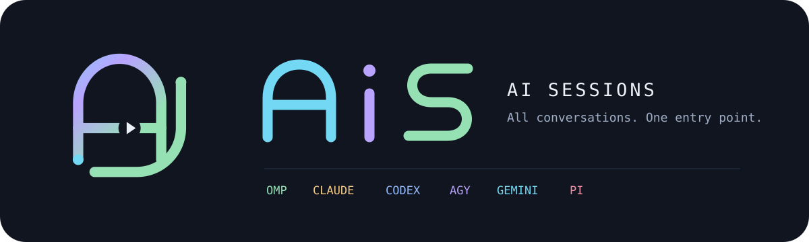
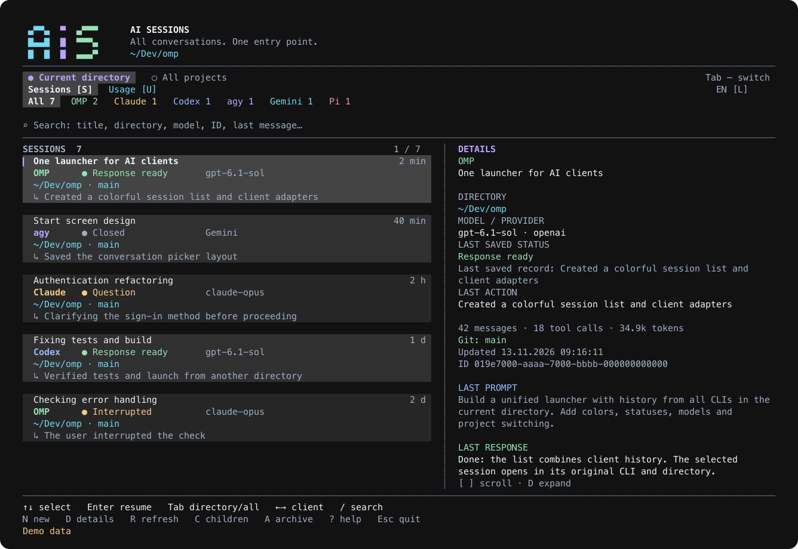
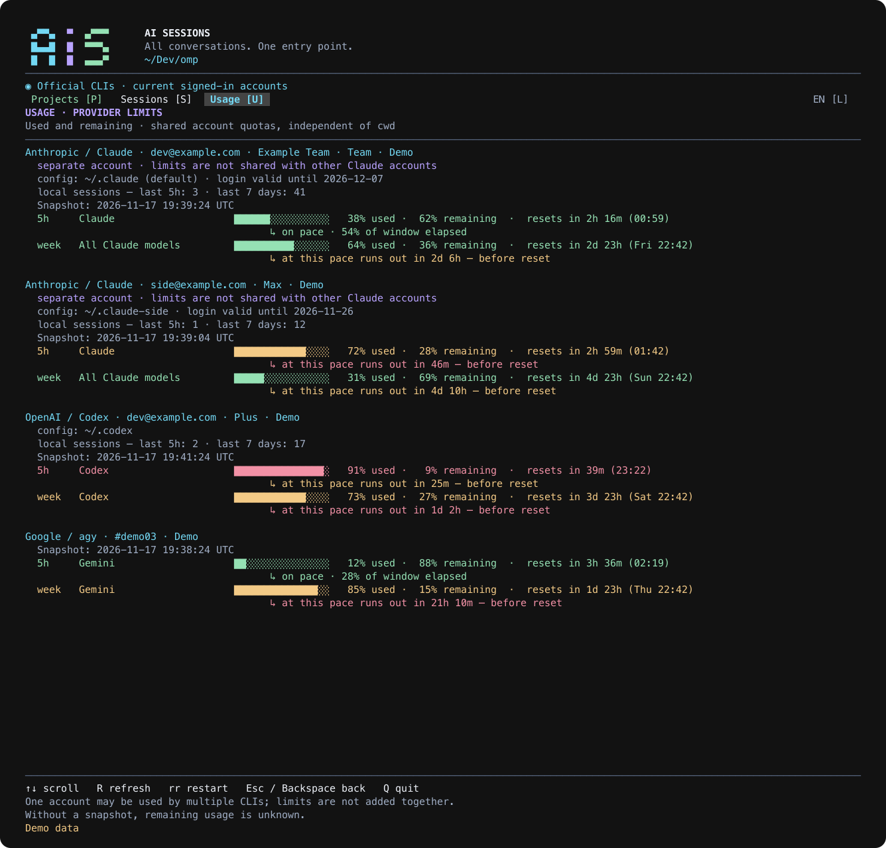

<p align="center"></p>

English · [Русский](README.ru.md)

**All conversations. One entry point.** A colorful local session browser for OMP, Claude Code, Codex, agy, Gemini CLI and Pi. Select a conversation to resume it in its original client and working directory.



## Run

Requires Python 3.10+ with `curses`, on macOS or Linux. No external Python dependencies.

```sh
git clone https://github.com/repentandliveholy/ais.git
cd ais
./ais
```

The launcher works from any directory. It opens on **Projects**, a flat list of folders with saved sessions. `T` switches to a nested project tree. Press `S` for the **current-directory** session list; `Tab` opens Sessions and switches between current directory and all projects. Sessions always launch in their **own directories**.

After `/exit` or another CLI exit, ais automatically returns to the browser and reloads history. Search, filters and selection are preserved. Exit codes and signals appear in the footer. A `Ctrl+C` that interrupts a response inside the CLI does not close the waiting launcher.

Use `ais --no-return` for direct execution without returning. Interactive `--new` and `--resume` also return to the browser by default; scripts without a TTY launch once.

To add a short command to your PATH:

```sh
mkdir -p ~/.local/bin
ln -s "$PWD/ais" ~/.local/bin/ais
```

This does not overwrite an existing file. Alternatively, install with `pip install .` in your environment.

**Desktop app:** [`ais-shell/`](ais-shell/README.md) is a native window for the same histories: live per-CLI agent status (working / waiting / needs you / error), a 5h/week usage panel, one-click resume, a real terminal (alacritty engine, kitty keys, mouse, bracketed paste) with split panes, and a ⌘P command palette. `./ais-shell/bundle.sh --install` builds `ais.app`.

**Projects** is the start screen: a flat list of folders with saved sessions, ordered by last activity — the same behavior as before. `T` toggles a nested tree, where subfolders appear inside their parent folder with tree guides. `Enter` on a folder with subprojects opens that folder: the list shows its direct subfolders with sessions and the folder’s own sessions. `Enter` on a leaf folder opens its Sessions list; on a session it resumes. `O` opens the selected folder’s sessions directly. `Esc` or `Backspace` goes up one folder and then back to the Projects root. Search and client filters work on this page. Full paths distinguish folders with the same name; sessions without a directory have their own group.

When ais runs inside Warp on macOS, resume and new-session actions open a project tab named after the folder. ais stays in its original tab. Tabs created by ais are reused by full canonical folder path: an idle tab runs the selected session; a busy tab is focused without interrupting its agent. Tabs opened independently of ais are not registered for reuse. `--same-tab` keeps the original launch behavior; `--new-tab` explicitly enables Warp tabs. `--no-return` keeps direct execution unless combined with `--new-tab`. This uses Warp’s file URI handler and `WARP_FOCUS_URL`; the original ais tab reports any launch error.

New project tabs contain the main session on the left and two ordinary project terminals stacked on the right. Warp uses its standard equal splits; ais does not adjust pane sizes. Existing project tabs are reused without changing their layout.

## Language

**English is the default.** Press **`L`** in Sessions or Usage, choose **English / Русский**, then press `Enter`. `Esc` cancels. The choice is saved in `${XDG_CONFIG_HOME:-~/.config}/ai-sessions/settings.json`.

You can also select and save the language from the command line:

```sh
ais --lang en
ais --lang ru
```

Help, controls, statuses, details, errors and Usage labels follow the selected language. Conversation content and provider-supplied labels retain their original text.

## Controls

| Key | Action |
|---|---|
| `↑` / `↓`, mouse wheel / trackpad | Select a session or project; scroll limits in Usage |
| `Enter` | Open a folder with subprojects; on a leaf, open Sessions; on a session, resume in the original CLI |
| `O` | Open the selected folder’s sessions directly |
| `T` | Projects: flat list / nested tree |
| `Tab` | Sessions: current directory / all projects |
| `←` / `→` | Filter by client |
| `/` or `.` (Russian layout) | Search titles, directories, models, IDs and available messages |
| `Esc` | Close a dialog, return from Usage, go up one project folder, or reset Sessions to the current-directory list; keeps ais open |
| `Backspace` | Back from a folder, Sessions or Usage; edits the query while searching |
| `PgUp` / `PgDn`, `Home` / `End` | Page through the list or jump to its edges |
| `D` | Expand details, including on narrow terminals |
| `[` / `]` | Scroll details |
| `N` | New session in the current directory |
| `Shift+N` | New session in the selected conversation's directory |
| `U` / `S` | Usage / Sessions |
| `R` | Reload history; request current limits in Usage |
| `rr` | Restart ais (press `r` twice within half a second) |
| `L` | Choose and save the interface language |
| `C` | Show or hide child sessions when recorded by the client |
| `A` | Show or hide the Codex archive |
| `j` / `k`, `g` / `G` | Vim-style down / up, first / last |
| `0`–`6` | Client filter: All, OMP, Claude, Codex, agy, Gemini, Pi |
| Mouse click / double-click | Select a row, tab, scope or client chip / open or resume |
| `F` (or `*`) | Pin / unpin the selected session or folder; pinned rows stay on top and are marked ★ |
| `y` / `Y` | Copy the resume command (`cd … && …`) / the session ID or folder path |
| `E` | Open the selected directory in Finder / the file manager |
| `?` | Help: all keys and search syntax (scroll with ↑↓ on small terminals) |
| `Q`, `Ctrl+C` | Quit |

### Search syntax

Plain words must all match (title, directory, model, ID, branch, last messages); matches are highlighted. Filters can be combined:

| Filter | Meaning |
|---|---|
| `-word` | Exclude rows containing the word |
| `"two words"` | Exact phrase |
| `client:claude` (`c:`, `cli:`) | Client by name prefix |
| `model:opus` (`m:`) | Model or provider substring |
| `status:error` (`st:`) | Saved status (English key or localized label) |
| `branch:main` (`b:`), `dir:api` (`in:`), `profile:` | Git branch, directory, OMP profile |
| `since:3d` (`age:`) | Updated within `90m`, `6h`, `3d`, `2w`, `today`, `yesterday` |
| `is:pinned`, `is:child`, `is:archived` | Pinned rows; child sessions or the Codex archive even when hidden |

Any filter can be negated with `-`, for example `-status:error`. The same syntax works with `--query`. In the search field `Ctrl+U` clears the query and `Ctrl+W` deletes the last word.

Pins and the last CLI chosen in **New session** (also selectable with `1`–`6`) are saved in `settings.json` next to the language.

Search input starts only after `/` or `.`. Other unbound text is ignored. `Enter` finishes editing the query; press `/` or `.` to edit it again.

On wide terminals, details appear on the right. On narrow terminals, open them with `D`. The full wordmark appears when there is enough vertical space.

`R` reloads history, selects the first row and scrolls to the top. Search and filters are preserved. The old list stays visible until all sources finish reloading. Pressing `R` during a background scan queues a refresh without changing the search query. In Usage, `R` also scrolls to the top.

History refreshes automatically every **10 seconds** while Projects or Sessions is open. Usage refreshes every **60 seconds** while its panel is open. Intervals start after the previous refresh finishes; requests do not overlap. Search, filters and the selected session are preserved. Use `ais --no-auto-refresh` to disable periodic refresh; `R` still works. With `--cached-usage`, Usage refreshes local snapshots only.

Wheel input is handled explicitly, including older macOS ncurses. Queued wheel reports are drained before a move; only the latest direction is used, without replaying old motion. Continuous scrolling moves one session card or one Usage/detail line at most every 40 ms. Ignored reports do not delay the next step or create motion to replay after input stops. Reversing direction moves immediately, including at either edge. Keyboard input is preserved. Scrolling clamps to the actual content after a resize or data refresh. Alternate-screen arrow emulation is temporarily disabled and restored on exit.

SGR mouse reporting stays enabled on older macOS ncurses too: ais decodes those reports directly, since Warp otherwise converts scrolling into arrow keys. Until the terminal supplies its first mouse report, repeated Up/Down input uses the same 40 ms speed limit. Page Up/Down and Home/End remain available for larger jumps.

## Session information

The browser shows the client, title, updated time, directory, model, provider, branch and OMP profile when available. Details include the last saved status, action, prompt and response; session ID and dates; message/tool counts, tokens and cost where recorded. OMP tasks, tool intentions and exit events are included when available.

Client colors: OMP mint, Claude amber, Codex blue, agy lavender, Gemini cyan and Pi pink. Status labels remain readable without color.

Statuses describe the **last saved record**. They do not establish whether a process is currently running or a task succeeded. The launcher does not modify client models, permission settings or history formats.

## Usage: 5h / week



`U` opens a separate panel with used and remaining percentages and reset times. Bars become amber or pink at high utilization. Old or expired snapshots are marked **stale** in the reset line. Repeated “Data … ago” rows are omitted. Unknown remaining usage is never treated as zero utilization.

### Accounts

Limits are grouped **per account**, not per CLI. Each block shows the account email, organization and plan as reported by the official CLI, the config dirs that use it, login expiry, Codex credits, and local activity (session files touched in the last 5 hours / 7 days). Every bar shows the reset countdown with local clock time and a **pace forecast**: on pace, ahead of an even pace, or "runs out in 1h 20m — before reset".

Extra stores are discovered automatically: every `~/.claude-*` folder with `projects/` or `.claude.json` and every `~/.codex-*` folder with `sessions/` or `auth.json` (for example `CLAUDE_CONFIG_DIR=~/.claude-work claude`). Their sessions also appear in the browser, labelled with the folder suffix as a profile (`profile:work` in search). For Claude, ais asks `claude auth status --json` in each store: two different logins become two separate blocks; several folders signed in to the same account are merged into one block that says so. `/usage` runs once per account from a folder that config already trusts. Codex identity comes from the app-server `account/read` request.

agy has no account command, so ais reads the signed-in email and auth method from the agy log written by that same `/usage` run (older logs are never used).

**DeepSeek API balance.** DeepSeek has no CLI, so this is the one direct HTTPS request ais makes: `GET https://api.deepseek.com/user/balance`, only when a key is configured. Set `DEEPSEEK_API_KEY`, or run `ais --set-deepseek-key` (hidden input, saved with mode `600` to `~/.config/ai-sessions/deepseek.key`; empty input removes it). Usage then shows the total, topped-up and granted balance per currency and warns when it is exhausted. The key is never displayed (only `key …abcd`), logged or included in errors.

Opening the panel starts background requests through installed official CLIs only:

- **Codex:** `codex app-server`, using the documented `initialize` / `initialized` handshake and `account/rateLimits/read`. Displays the quota windows and multiple buckets reported by the CLI, without duplicating its legacy single-bucket view. No model turn is started.
- **agy:** `agy -p /usage`, the supported standalone report. Its native TSV rows provide the model group, quota window, remaining percentage and ISO reset timestamp. ais converts remaining to used percentage and shows the same bars and reset lines as the other CLIs. Claude/GPT groups remain hidden; Gemini groups and separate model pools such as Gemini 4 Argon are retained.
- **Claude:** starts the official interactive CLI in a private PTY with `--safe-mode --ax-screen-reader --tools ""`, waits for its prompt, then submits only the built-in `/usage` command. The native current-session and weekly model windows become the same usage bars. Local attribution percentages, session token counts and custom status lines are excluded. Native human reset text is retained with its timezone; ais does not guess an epoch from natural language. This path was checked against authenticated Claude Code 2.1.325 with zero API duration and zero tokens. Trust/login prompts are never answered automatically. A login visible in an ordinary terminal may be inaccessible to a sandbox; ais reports that separately.

`R` repeats requests; Usage also refreshes every 60 seconds when visible. Requests run in the background, have a 30-second timeout per CLI, and are cancelled when ais exits. A missing CLI, rejected request, unexpected format or timeout produces an explicit source error. No Usage path launches OMP, reads its usage database, extracts OAuth credentials or makes provider HTTP requests itself. The former `O` report shortcut is removed.

Successful official snapshots are saved atomically with mode `600` in `${XDG_CACHE_HOME:-~/.cache}/ai-sessions/official-usage-*.json`. The cache is isolated by the selected home and CLI stores. Each source displays its successful snapshot timestamp in local time with its UTC offset and its live/cached label; the last request time is separate. Failed refreshes retain the previous snapshot and timestamp, labelled cached. Cached data may belong to an earlier CLI login. `--no-cache` disables reading and saving these snapshots; `--cached-usage` reads them without launching a CLI. Old OMP snapshots and Codex rollout events are not imported. Earlier official agy TSV snapshots migrate to bars with their original timestamps; unsupported text is marked unavailable. The first selected Codex and Claude stores use `CODEX_HOME` and `CLAUDE_CONFIG_DIR`; alternate agy stores are explicitly unavailable because the CLI has no documented override for usage.

Opening Sessions does not request usage. Official CLIs manage their own login and network access. Provider error bodies and stderr are not copied into ais. Account emails reported by `claude auth status` and Codex `account/read` are shown locally and kept in the `600` cache; raw account IDs are hashed and email addresses in the agy report are masked. Session token counts never establish remaining plan quota.

The interfaces were checked against [Codex App Server](https://developers.openai.com/codex/app-server/), [agy headless mode](https://antigravity.google/docs/cli/headless), and [Claude commands](https://code.claude.com/docs/en/commands), plus the installed CLI help. Tests use fake CLIs and real PTYs to verify dispatch, refresh, cancellation, errors, caching and terminal responsiveness. Live requests may still fail due to local permissions, sandboxing, login or provider restrictions; ais reports those failures instead of substituting values.

## Command examples

```sh
./ais --all
./ais --sessions
./ais -C ~/Dev/mesh --client omp
./ais --all --query "authentication"
./ais --lang en
./ais --usage
./ais --usage --json
./ais --usage --cached-usage
./ais --all --json
./ais --doctor
./ais --last                        # resume the newest session in this directory
./ais --last --client claude --print-command
./ais --all --list -q "since:2d -status:error" -n 20
./ais --stats                       # clients, top projects, models, statuses, activity
./ais --stats --json
./ais --resume SESSION_ID --print-command
./ais --resume SESSION_ID --client claude
./ais --new codex
./ais --no-return
```

Terminal modes are restored before launching a client. ais passes an argument array without a shell and uses the client's real stdin/stdout/stderr, with no intermediate PTY. The child runs in the session's directory; the parent keeps its original working directory.

## History sources

| Client | Default source | Resume |
|---|---|---|
| OMP | `~/.omp/agent/sessions`, titles from `history.db`, profiles in `~/.omp/profiles/*/agent` | `omp --resume <path>` |
| Claude | `~/.claude/projects/**/*.jsonl` | `claude --resume <id>` |
| Codex | `~/.codex/sessions`, `archived_sessions`, `state_*.sqlite` | `codex resume <id> --cd <directory>` |
| agy | `~/.gemini/antigravity-cli/conversation_summaries.db`, text from its search index | `agy --project <project> --conversation <id>` |
| Gemini | `~/.gemini/tmp/*/chats/session-*.json` and project mappings | `gemini --resume <id>` |
| Pi | `~/.pi/agent/sessions` | `pi --session <path>` |

`CODEX_HOME`, `CLAUDE_CONFIG_DIR`, `PI_CODING_AGENT_DIR` and `PI_CODING_AGENT_SESSION_DIR` are supported. Override sources explicitly with:

```sh
./ais --source omp=/path/to/agent --source codex=/path/to/codex-home
```

Gemini history remains visible if the original project directory cannot be resolved, but resume is disabled. Custom agy and Gemini stores support browsing only, since no resume argument for selecting those stores has been confirmed. Missing clients/directories and ambiguous IDs prevent launch; ais does not install clients.

## Index and privacy

ais reads source files and databases without editing them and accounts for SQLite WAL. Launched official CLIs may update their own caches and authorization normally.

The ais index is stored in `${XDG_CACHE_HOME:-~/.cache}/ai-sessions` with `600` file permissions. It contains titles and conversation snippets and should not be published. Generated metadata is cached per language. The language preference is stored separately from the history index.

Large JSONL files are initially sampled from the start and end; sampled counters use `≥`. Full details load in the background for the selected session. Unchanged files reuse the index.

```sh
./ais --no-cache
./ais --cache-dir .ais-cache
```

Screenshots in `artifacts/` contain **demo data** only.

## Development

```sh
python3 -m unittest discover -s tests -v
./ais --demo --snapshot artifacts/ais-preview.svg --cols 144 --rows 44
./ais --demo --usage --snapshot artifacts/ais-usage.svg --cols 144 --rows 44
```

Tests cover adapters, partial JSONL, WAL, directory selection, caching, usage parsing, project trees and ambiguous IDs. Real PTY tests cover the default Projects view, folder drill-down, Backspace navigation, colors, search, resize, Usage, language selection and persistence, wheel bursts, exact launch arguments and restoration of `ECHO` / `ICANON`.
