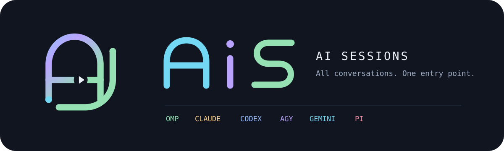
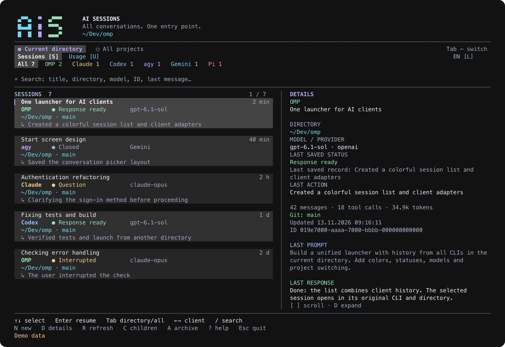
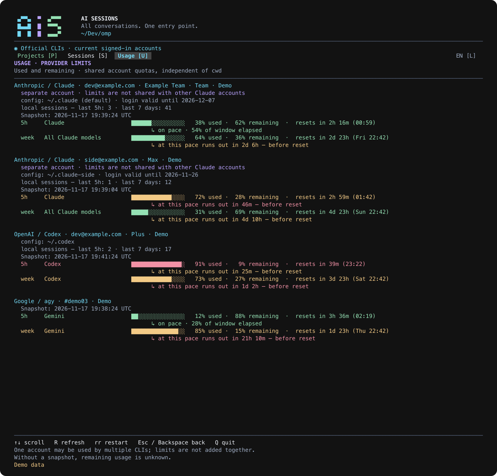

<p align="center"></p>

[English](README.md) · Русский

**Все диалоги. Один вход.** Цветная стартовая оболочка для истории OMP, Claude Code, Codex, agy, Gemini CLI и Pi. Выбираешь диалог — запускается исходный клиент в каталоге этой сессии.



## Запуск

Нужен Python 3.10+ с `curses`, macOS или Linux. Внешних Python-зависимостей нет.

```sh
git clone https://github.com/repentandliveholy/ais.git
cd ais
./ais
```

Команда работает из любого каталога. При запуске открываются **Проекты** — плоский список папок с сохранёнными сессиями. `T` переключает древовидный вид. `S` открывает список сессий **текущего каталога**; `Tab` переключает сессии между текущим каталогом и всеми проектами. Выбранная сессия всегда запускается в **своём** каталоге.

После `/exit` или другого завершения CLI оболочка **автоматически возвращается к списку ais**. Поиск, фильтры и выделенный диалог сохраняются, история перечитывается. При ошибке или завершении сигналом внизу виден код/сигнал. `Ctrl+C`, который прервал только ответ внутри CLI, не закрывает ожидающую оболочку.

Для прямого запуска без возврата: `ais --no-return`. При использовании `--new` и `--resume` в обычном терминале возврат тоже включён; в скриптах без TTY сохраняется однократный запуск.

Чтобы обращаться к оболочке короткой командой из любого терминала:

```sh
mkdir -p ~/.local/bin
ln -s "$PWD/ais" ~/.local/bin/ais
```

`~/.local/bin` должен быть в `PATH`. Существующий файл эта команда не перезаписывает. Альтернатива: `pip install .` в своём окружении.

**Десктоп-приложение:** [`ais-shell/`](ais-shell/README.md) — нативное окно для тех же историй: живой статус каждого CLI (работает / ждёт ввода / нужен вы / ошибка), панель лимитов 5ч/неделя, возобновление разговора в один клик, настоящий терминал (движок alacritty, kitty-клавиши, мышь, bracketed paste) с делением на панели и палитра команд ⌘P. `./ais-shell/bundle.sh --install` собирает `ais.app`.

**Проекты** — стартовый экран: плоский список папок с сохранёнными сессиями, упорядоченный по последней активности, как было раньше. `T` переключает дерево, где подпапки показываются внутри родительской папки с направляющими. `Enter` на папке с подпроектами входит в неё: показываются прямые подпапки с сессиями и сессии самой папки. `Enter` на конечной папке открывает её сессии; на сессии — продолжает диалог. `O` сразу открывает сессии выбранной папки. `Esc` или `Backspace` поднимает на уровень выше и затем возвращает к корню проектов. На странице работают поиск и фильтр клиентов. Полные пути различают одноимённые папки; сессии без каталога собраны в отдельную группу.

При запуске ais внутри Warp на macOS вход в сессию и создание новой открывают вкладку проекта с названием папки. ais остаётся в исходной вкладке. Вкладки, созданные ais, повторно используются по полному пути папки: свободная запускает выбранную сессию, занятая получает фокус без прерывания агента. Вкладки, открытые отдельно от ais, не зарегистрированы для повторного использования. `--same-tab` сохраняет запуск в текущей вкладке, `--new-tab` явно включает вкладки Warp. `--no-return` сохраняет прямой запуск, если не указан `--new-tab`. Используются обработчик файловых URI Warp и `WARP_FOCUS_URL`; ошибки запуска отображаются в исходной вкладке ais.

Новые вкладки проекта содержат основную сессию слева и два обычных терминала проекта справа друг над другом. Используется стандартное равное деление Warp; ais не меняет размеры панелей. Существующие вкладки повторно используются без изменения раскладки.

## Язык интерфейса

По умолчанию интерфейс на английском. Нажмите `L`, выберите English или Русский и подтвердите `Enter`. Выбор сохраняется в `${XDG_CONFIG_HOME:-~/.config}/ai-sessions/settings.json`. Также можно запустить `ais --lang en` или `ais --lang ru`; параметр тоже сохраняет выбор. Тексты диалогов не переводятся.

## Управление

| Клавиша | Действие |
|---|---|
| `↑` / `↓`, колесо мыши / трекпад | Выбрать сессию или проект; в Usage — прокрутить лимиты |
| `L` | Выбрать и сохранить язык EN / RU |
| `Enter` | Войти в папку с подпроектами; на конечной папке — открыть сессии; на сессии — продолжить в исходном CLI |
| `O` | Сразу открыть сессии выбранной папки |
| `T` | Проекты: плоский список / дерево |
| `Tab` | Сессии: текущий cwd / все проекты |
| `←` / `→` | Фильтр по клиенту |
| `/` или `.` в русской раскладке | Поиск по названию, каталогу, модели, ID и доступным сообщениям |
| `Esc` | Закрыть окно, вернуться из Usage, подняться на уровень выше в проектах или сбросить сессии к текущему каталогу; приложение остаётся открытым |
| `Backspace` | Назад из папки, сессий или Usage; при поиске удаляет символ |
| `PgUp` / `PgDn`, `Home` / `End` | Навигация по списку |
| `D` | Развернуть подробности; удобно на узком экране |
| `[` / `]` | Прокрутить подробности |
| `N` | Выбрать CLI и начать новую сессию в текущем cwd |
| `Shift+N` | Новая сессия в каталоге выделенного диалога |
| `U` | Вкладка Usage: лимиты провайдеров |
| `S` | Вернуться к сессиям |
| `R` | Перечитать историю; в Usage — запросить актуальные лимиты через официальные CLI |
| `rr` | Перезапустить ais: два нажатия `r` за полсекунды |
| `C` | Показать или скрыть дочерние сессии, если клиент записал связь |
| `A` | Показать или скрыть архив Codex |
| `j` / `k`, `g` / `G` | Вниз / вверх, первая / последняя (как в Vim) |
| `0`–`6` | Фильтр клиента: Все, OMP, Claude, Codex, agy, Gemini, Pi |
| Клик / двойной клик мышью | Выбрать строку, вкладку, область или клиента / открыть или продолжить |
| `F` (или `*`) | Закрепить / открепить сессию или папку; закреплённые всегда сверху и помечены ★ |
| `y` / `Y` | Скопировать команду продолжения (`cd … && …`) / ID сессии или путь папки |
| `E` | Открыть каталог в Finder / файловом менеджере |
| `?` | Справка: все клавиши и синтаксис поиска (на маленьком терминале — прокрутка ↑↓) |
| `Q`, `Ctrl+C` | Выход |

Ввод поиска включается только после `/` или `.`. Остальной текст вне поиска игнорируется, если он не назначен горячей клавише. `Enter` завершает ввод; чтобы изменить запрос, снова нажмите `/` или `.`.

Интерфейс адаптируется к размеру терминала. На широком экране подробности находятся справа. На узком — открываются через `D`. Полноценный логотип показывается при достаточной высоте окна; в маленьком остаётся компактный знак.

`R` перечитывает историю, выбирает первую строку и прокручивает список наверх. Поиск и фильтры сохраняются. Во время перечитывания старый список остаётся на экране; после завершения всех источников он обновляется целиком. Нажатие `R` во время фоновой загрузки ставит обновление в очередь и не меняет поисковый запрос. В Usage клавиша `R` тоже возвращает прокрутку наверх.

История автоматически обновляется каждые **10 секунд**, пока открыты проекты или сессии. Лимиты обновляются каждые **60 секунд**, пока открыта Usage. Интервал отсчитывается от завершения предыдущего обновления; запросы не накладываются друг на друга. Поиск, фильтры и выбранная сессия сохраняются. `ais --no-auto-refresh` отключает периодическое обновление, при этом `R` продолжает работать. С `--cached-usage` перечитываются только локальные снимки лимитов.

Перед перемещением очередь событий трекпада вычитывается: учитывается только последнее направление, старые движения не воспроизводятся. Непрерывная прокрутка перемещает на одну карточку сессии или одну строку Usage/подробностей не чаще раза в 40 мс. Пропущенные события не отодвигают следующий шаг и не накапливают отложенную прокрутку. Обратное движение срабатывает сразу, в том числе на краях списка. Клавиатурный ввод сохраняется.

Современный формат мыши SGR включён и на старом macOS ncurses: ais разбирает его напрямую, иначе Warp превращает прокрутку в стрелки. До первого настоящего сообщения мыши серии `↑`/`↓` используют то же ограничение скорости — шаг за 40 мс. Для больших переходов доступны PgUp/PgDn и Home/End.

### Синтаксис поиска

Все обычные слова должны совпасть (название, каталог, модель, ID, ветка, последние сообщения); совпадения подсвечиваются. Фильтры комбинируются:

| Фильтр | Значение |
|---|---|
| `-слово` | Исключить строки с этим словом |
| `"два слова"` | Точная фраза |
| `client:claude` (`c:`, `cli:`) | Клиент по началу имени |
| `model:opus` (`m:`) | Подстрока модели или провайдера |
| `status:error` (`st:`) | Сохранённый статус (английский ключ или русская подпись, например `status:ошибка`) |
| `branch:main` (`b:`), `dir:api` (`in:`), `profile:` | Ветка git, каталог, профиль OMP |
| `since:3d` (`age:`) | Обновлена за `90m`, `6h`, `3d`, `2w`, `today`/`сегодня`, `yesterday`/`вчера` |
| `is:pinned`, `is:child`, `is:archived` | Закреплённые; дочерние сессии или архив Codex, даже если они скрыты |

Любой фильтр можно инвертировать через `-`, например `-status:error`. Тот же синтаксис работает в `--query`. В поле поиска `Ctrl+U` очищает запрос, `Ctrl+W` удаляет последнее слово.

Закрепления и последний выбранный CLI в окне **New session** (там же выбор цифрами `1`–`6`) сохраняются в `settings.json` рядом с языком.

## Что видно в истории

- Клиент, название диалога, время обновления и каталог.
- Модель и провайдер, если они записаны; Git-ветка и профиль OMP.
- Последнее **сохранённое** состояние: ответ, вопрос, инструмент, размышление, ошибка, прерывание или закрытие CLI.
- Для OMP — намерение последнего инструмента, событие выхода, задачи и их состояние, если эти записи доступны.
- Последний запрос и ответ, ID, даты, счётчики сообщений и вызовов, токены и стоимость, когда клиент их сохранил.
- Команда продолжения и путь к исходному файлу.

Цвет закреплён за клиентом: OMP — мятный, Claude — янтарный, Codex — синий, agy — лавандовый, Gemini — голубой, Pi — розовый. Статус подписан текстом, поэтому интерфейс понятен и без различения цветов.

Статус относится к последней записи в истории. Он **не означает**, что процесс сейчас работает или задача выполнена успешно. Например, «Закрыта» означает завершение CLI, а «Ответ готов» — наличие ответа/события завершения хода. Оболочка не изменяет модели, настройки разрешений или формат истории клиентов.

## Usage: 5h / week



`U` открывает отдельную вкладку с использованным лимитом, остатком, временем сброса. Полосы становятся янтарными и розовыми при высоком использовании. Истёкшие или старые снимки помечены как устаревшие прямо в строке сброса. Повторяющиеся строки «Данные … назад» убраны. Неизвестный остаток не превращается в `0%` использования.

При открытии Usage выполняются фоновые запросы только через установленные официальные CLI:

- **Codex:** `codex app-server`, документированное рукопожатие `initialize` / `initialized` и метод `account/rateLimits/read`. Показываются окна и группы квот из ответа CLI; дублирующее старое представление одной квоты не добавляется. Запрос к модели не запускается.
- **agy:** `agy -p /usage`, поддерживаемый отдельный отчёт. Его штатные TSV-строки содержат группу моделей, окно квоты, процент остатка и ISO-время сброса. ais переводит остаток в использованный процент и показывает такие же полосы и строки сброса, как у других CLI. Группы Claude/GPT скрыты; Gemini и отдельные пулы вроде Gemini 4 Argon сохранены.
- **Claude:** официальный интерактивный CLI запускается в отдельном PTY с `--safe-mode --ax-screen-reader --tools ""`; после появления приглашения отправляется только встроенная команда `/usage`. Текущая сессия и недельные окна моделей превращаются в общие полосы использования. Проценты локальных рекомендаций, токены сессий и пользовательская status line исключены. Штатный текст времени сброса с часовым поясом сохраняется; ais не угадывает Unix-время по естественному языку. Путь проверен на авторизованном Claude Code 2.1.325 с нулевой длительностью API и нулевыми токенами. Запросы доверия к каталогу и входа автоматически не подтверждаются. Sandbox может не видеть вход, доступный обычному терминалу; ais показывает эту ошибку отдельно.

`R` повторяет запросы; открытая Usage также обновляется каждые 60 секунд. Запросы идут в фоне, имеют таймаут 30 секунд на CLI и отменяются при выходе из ais. Отсутствующий CLI, отклонённый запрос, неожиданный формат и таймаут отображаются как ошибки источника. Usage не запускает OMP, не читает его базу лимитов, не извлекает OAuth-данные и самостоятельно не обращается к HTTP API провайдеров. Прежняя клавиша отчёта `O` удалена.

Успешные снимки официальных CLI атомарно сохраняются с правами `600` в `${XDG_CACHE_HOME:-~/.cache}/ai-sessions/official-usage-*.json`. Кеш разделён по выбранному домашнему каталогу и хранилищам CLI. У каждого источника показаны время успешного снимка в UTC и метка актуальных/сохранённых данных; время последнего запроса указано отдельно. Ошибка обновления сохраняет прежний снимок с исходным временем и меткой кеша. Снимок может относиться к прежнему аккаунту CLI. `--no-cache` отключает чтение и запись этих снимков; `--cached-usage` читает их без запуска CLI. Старые снимки OMP и события из истории Codex не импортируются. Ранее сохранённые официальные TSV-отчёты agy переводятся в полосы с исходным временем; неподдерживаемый текст помечается как недоступный. Первые выбранные каталоги Codex и Claude передаются через `CODEX_HOME` и `CLAUDE_CONFIG_DIR`; другой каталог agy явно недоступен для Usage, поскольку документированного способа передать его нет.

### Учётные записи

Лимиты сгруппированы **по учётным записям**, а не по CLI. В каждом блоке — email, организация и план (по данным официального CLI), каталоги конфига, срок действия входа, кредиты Codex и локальная активность (файлы сессий за последние 5 часов / 7 дней). У каждой полосы — обратный отсчёт до сброса с местным временем и **прогноз темпа**: в пределах темпа, быстрее равномерного или «при таком темпе закончится через 1 ч 20 мин — до сброса».

Дополнительные хранилища находятся автоматически: каждая папка `~/.claude-*` с `projects/` или `.claude.json` и каждая `~/.codex-*` с `sessions/` или `auth.json` (например, `CLAUDE_CONFIG_DIR=~/.claude-work claude`). Их сессии тоже видны в списке, с суффиксом папки как профилем (`profile:work` в поиске). Для Claude ais спрашивает `claude auth status --json` в каждом хранилище: два разных входа — два отдельных блока; несколько папок с одной и той же учёткой объединяются в один блок с пометкой об этом. `/usage` запускается один раз на учётку из папки, которой этот конфиг уже доверяет. Учётка Codex берётся из запроса app-server `account/read`.

Список сессий не запрашивает лимиты. Официальные CLI сами управляют входом и сетью. Тела ошибок провайдеров и stderr не копируются в ais; email из `claude auth status` и Codex `account/read` показываются локально и хранятся в кэше с правами `600`; сырые ID аккаунтов хешируются, email в отчёте agy маскируется. По токенам сессий остаток квоты не вычисляется.

Интерфейсы сверены с [Codex App Server](https://developers.openai.com/codex/app-server/), [headless-режимом agy](https://antigravity.google/docs/cli/headless), [командами Claude](https://code.claude.com/docs/en/commands) и справкой установленных CLI. Тестовые CLI и реальные PTY проверяют запуск, обновление, отмену, ошибки, кеш и отзывчивость терминала. Реальный запрос может завершиться ошибкой из-за прав, sandbox, входа или ограничений провайдера; ais показывает эту ошибку без подстановки значений.

## Примеры команд

```sh
./ais --all
./ais --sessions
./ais -C ~/Dev/mesh --client omp
./ais --all --query "авторизация"
./ais --usage
./ais --usage --json
./ais --usage --cached-usage
./ais --all --json
./ais --doctor
./ais --last                        # продолжить самую свежую сессию в этом каталоге
./ais --last --client claude --print-command
./ais --all --list -q "since:2d -status:error" -n 20
./ais --stats                       # клиенты, крупнейшие проекты, модели, статусы, активность
./ais --stats --json
./ais --resume SESSION_ID --print-command
./ais --resume SESSION_ID --client claude
./ais --new codex
./ais --no-return
```

Перед запуском CLI восстанавливается режим терминала. ais запускает дочерний процесс с теми же stdin/stdout/stderr, ожидает его завершения и снова открывает список. Рабочий каталог родителя остаётся исходным; каталог дочернего процесса выбирается по сессии. При `--no-return` используется прямой `exec`. Промежуточного PTY, переноса диалога или обработки запросов оболочкой нет. Аргументы передаются массивом, без исполнения через shell.

## Источники и ограничения адаптеров

| Клиент | Источник по умолчанию | Продолжение |
|---|---|---|
| OMP | `~/.omp/agent/sessions`, названия из `history.db`, профили `~/.omp/profiles/*/agent` | `omp --resume <путь>` |
| Claude | `~/.claude/projects/**/*.jsonl` | `claude --resume <id>` |
| Codex | `~/.codex/sessions`, `archived_sessions`, индекс `state_*.sqlite` | `codex resume <id> --cd <каталог>` |
| agy | `~/.gemini/antigravity-cli/conversation_summaries.db`, текст из поискового индекса | `agy --project <project> --conversation <id>` |
| Gemini | `~/.gemini/tmp/*/chats/session-*.json` и соответствие проектов | `gemini --resume <id>` |
| Pi | `~/.pi/agent/sessions` | `pi --session <путь>` |

Поддерживаются `CODEX_HOME`, `CLAUDE_CONFIG_DIR`, `PI_CODING_AGENT_DIR`, `PI_CODING_AGENT_SESSION_DIR`, а также явные источники:

```sh
./ais --source omp=/path/to/agent --source codex=/path/to/codex-home
```

История Gemini с хешированным именем проекта отображается даже тогда, когда исходный каталог восстановить нельзя. В таком случае продолжение отключено. Для нестандартных каталогов данных agy и Gemini доступен просмотр; продолжение из них отключено, поскольку подтверждённого аргумента выбора хранилища у этих клиентов нет.

Сессия не запускается, если CLI не установлен, исходный каталог пропал или ID неоднозначен. Установка клиента через оболочку не выполняется. «Все клиенты» здесь означает подключённые адаптеры; для другого формата нужен новый адаптер.

## Индекс и приватность

ais открывает файлы истории и базы снимков для чтения, SQLite WAL учитывается. Сам ais не редактирует исходную историю, авторизацию и настройки. Запускаемые официальные CLI работают штатно и могут обновлять свои кеши и авторизацию. Собственный индекс ais лежит в `${XDG_CACHE_HOME:-~/.cache}/ai-sessions`, файл имеет права `600`. Он содержит названия и фрагменты диалогов, поэтому его не следует публиковать.

При первом открытии большие JSONL читаются по началу и концу, список появляется постепенно. Счётчики такой выборки помечены `≥`. Для выделенной сессии полный файл читается фоново. Неизменённые файлы берутся из индекса. В этой установке повторное открытие индекса занимало около 0,4 секунды; первый обход более 1600 сессий — около 6 секунд.

```sh
./ais --no-cache
./ais --cache-dir .ais-cache
```

В `artifacts/` находятся логотип, иконка и снимки **с демонстрационными данными**. Настоящая история в публичные примеры не включена.

## Разработка и проверка

```sh
python3 -m unittest discover -s tests -v
./ais --demo --snapshot artifacts/ais-preview.svg --cols 144 --rows 44
./ais --demo --usage --snapshot artifacts/ais-usage.svg --cols 144 --rows 44
```

Проверяются адаптеры, незавершённые JSONL, WAL, выбор каталога, кеш, лимиты, дерево проектов и неоднозначные ID. PTY-тесты проверяют стартовый экран проектов, вход в папки и подпапки, навигацию `Backspace`, цвета, поиск, изменение размера, Usage, запуск тестового CLI с точными аргументами и восстановление `ECHO` / `ICANON`. Настоящие диалоги не отправляются провайдерам в ходе тестов.

За основу взаимодействия взят [выбор диалогов agy](https://antigravity.google/docs/cli/commands/resume/): список по давности, поиск, выделение, подсказки клавиш. Логотип и цветовое оформление ais созданы отдельно. Команда продолжения Codex сверена с [OpenAI Docs](https://learn.chatgpt.com/docs/developer-commands#codex-resume).
