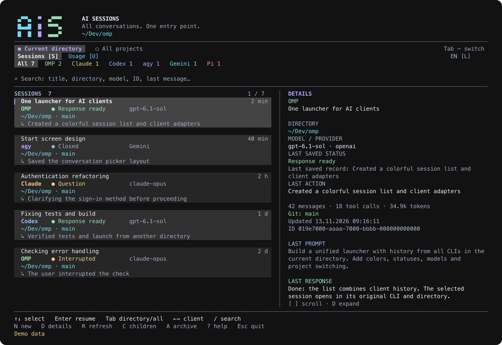

# ais · AI Sessions — desktop app

English · [Русский](README.ru.md)

A native, GPU-rendered workspace for AI coding CLIs: **Claude Code, Codex,
Gemini CLI, agy, OMP and Pi** side by side, per project, with live agent status,
plan usage limits and one-click resume of any saved conversation.

It is the windowed companion of the [`ais`](../README.md) terminal launcher and
reads the same local histories. No Electron, no account: one ~6 MB binary.



## Install

Requires a Rust toolchain (**1.89+** on macOS 11.0+, Windows 10/11, or Linux; Linux support is
currently experimental).

```sh
cd ais-shell
./bundle.sh --install        # macOS: builds dist/ais.app and copies it to /Applications
# or run directly (macOS / Linux / Windows)
cargo run --release -- ~/code/my-project --run claude
```

```
ais [PATH] [--run omp|claude|codex|agy|gemini|pi|shell] [--update] [--no-update-check]
```

### Updates

`ais` checks for signed updates (`ais-gui-latest.json` + Ed25519 signature + SHA-256) automatically once a day when **Auto-update** is enabled in **Settings → About** (disable with `AIS_NO_UPDATE=1` or `--no-update-check`), and atomically replaces the executable on macOS, Linux, and Windows. Run `ais --update` or click **Check for updates** in **Settings → About** to update manually.

Conversation lists and usage limits come from the companion `ais-cli`
([`../ais-cli`](../ais-cli)); `bundle.sh` copies it into `ais.app/Contents/Resources`.
It is found via `$AIS_BIN`, then `PATH` (`ais-cli` or `ais`), then beside the
executable / in bundle Resources. Without it the app still works as a multi-CLI
terminal workspace.

## Requirements

- **macOS:** macOS 11.0+. Built-in vector UI icons work out of the box; a Nerd
  Font (JetBrains Mono, Fira Code, or Hack) is optional for terminal Powerline /
  Nerd glyphs.
- **Windows:** Windows 10/11 (ConPTY). Uses `pwsh` / `powershell` / `cmd.exe`
  automatically for terminal panes and resolves `.cmd` / `.exe` AI CLIs from
  `PATH`.
- **Linux (experimental):** runtime utilities `zenity` (folder picker),
  `notify-send` (desktop alerts), and `xdg-open` (links and folders). Building
  from source requires `libxkbcommon-dev`, `libwayland-dev` / X11 dev headers,
  `libgl-dev`, and `libgtk-3-dev`.
  > Note: on Windows and Linux the default primary shortcut modifier is `Ctrl+`,
  > which intercepts terminal keys such as `Ctrl+D` and `Ctrl+W` unless rebound
  > in Settings (`Ctrl+,`).

## What you get

**Agents at a glance.** Under the project title there is one card per installed
CLI. Each card shows the live state of its panes across all projects, plus its
5-hour and weekly limits:

| State | Meaning |
|---|---|
| `● working` | the CLI is streaming output right now |
| `○ waiting for input · 2m` | running, idle, ready for your next prompt |
| `▲ needs you` | it finished a turn or rang the bell while you looked elsewhere |
| `! error · exit 1` | the process exited with a failure |
| `✓ finished` | exited cleanly; ↻ runs it again |
| `idle · last ready 1h` | nothing running; shows the last saved status from history |

Click a card with running sessions to jump to that agent (click again to cycle
through instances). When idle, **double-click** to start a new session, or
right-click for *continue last session*, *new in split*, *browse conversations*,
and *usage*. Space tabs carry the same signal and show `⌘1…9` hints.

**Usage panel (⌘U).** Plan limits per provider (Claude, Codex, agy/Gemini)
with used/left percentages, colored + symbol indicators (`▲` ≥ 70%, `!` ≥ 90%),
the time until reset, and data freshness. Cached snapshots load automatically;
background live refreshes through the official CLIs are **opt-in** in Settings
(`Terminal → Auto-refresh live usage limits`) and otherwise run only when you
click ↻.

**Resume anything.** The *Sessions* sidebar tab, the empty-pane start screen,
and the command palette list the saved conversations of the active project.
Configured extra CLI arguments and custom CLI binary overrides apply to new,
continued, and resumed sessions.

**A real terminal.** Panes use [`alacritty_terminal`](https://crates.io/crates/alacritty_terminal):

- Answers terminal queries (cursor position, device attributes, OSC 10/11
  colors), speaks the kitty keyboard protocol (`⇧↵` / `⌥↵` insert a newline in
  Claude, Codex and Gemini), and supports IME input (`Event::Ime`).
- Supports bracketed paste (with a confirmation dialog for multi-line raw
  pastes), mouse reporting (left/middle/right/hover; hold `⇧` to select), focus
  events, synchronized updates, 24-bit color, wide CJK/emoji glyphs, OSC 8
  hyperlinks, scrollback search (`⌘F`), and 10,000 lines of scrollback.
- Text selection survives constant TUI redraws. `⌘`-click opens URLs even when
  mouse mode is active. Dropping files on a pane pastes their quoted paths;
  dropping folders opens them as spaces.

**Settings (⌘,).** Organized into *Appearance*, *Terminal*, *Keyboard*, *CLIs*,
and *About*, with live search across all settings:

- **15 UI themes** (*ais*, *ais Soft*, *Mono*, *Nord*, *Nocturne*, *Tokyo Night*,
  *Gruvbox*, *Catppuccin*, *Solarized*, *GitHub*, *One*, *Rosé Pine*,
  *Everforest*, *Kanagawa*, *Ayu*), each with Light/Dark/System mode.
- **8 terminal palettes** (*ais (match UI)*, *Nocturne*, *Nord*, *Tokyo Night*,
  *Gruvbox*, *Catppuccin Mocha*, *Solarized Dark/Light*).
- UI scale, font selection & size, reduce motion, side-panel swap, center vs
  compact title bar, vim/arrow navigation, OSC 52 clipboard toggle, opt-in
  background live usage polling, custom CLI commands/flags, and settings reset.
- Stored in `${XDG_CONFIG_HOME:-~/.config}/ais/settings.json` (migrates automatically from `ais-shell/settings.json`; corrupt files are backed up to `settings.json.bak` with an alert).

## Keyboard

All listed shortcuts can be rebound or cleared in **Settings → Keyboard**.

| Keys | Action |
|---|---|
| `⌘P` | Search & run command palette (type a path like `~/Dev/app` to open it) |
| `⌘F` | Find in active pane scrollback |
| `⌘O` | Open folder as a project space |
| `⌘1…9` / `⌘⇧1…6` | Switch project space / Launch OMP, Claude, Codex, agy, Gemini, Pi |
| `⌘T` / `⌘D` / `⌘⇧D` | New terminal / Split right / Split down |
| `⌘W` / `⌘⇧W` | Close pane / Close space (asks confirmation when agents are running) |
| `⌘]` `⌘[` / `⌘⇧]` `⌘⇧[` | Next / previous pane · Next / previous space |
| `⌘⌥↑↓` / `⌘⌥←→` | Next / previous pane · Next / previous space (optional `⌘⌥H/J/K/L` vim mode) |
| `⌘↵` / `⌘⇧↵` / `⌘⇧R` / `⌘K` | Zoom active pane / Fullscreen terminal / Restart pane / Clear scrollback |
| `⌘=` `⌘-` `⌘0` | Bigger / smaller / reset terminal font size |
| `⌘B` / `⌘⇧E` / `⌘U` | Toggle sidebar / Files / Usage |
| `⌘⇧G` / `⌘⇧A` / `⌘⇧L` | Toggle agent pills / Toggle alerts / Toggle conversations |
| `⌘⌥⇧T` / `⌘⌥⇧R` | Cycle light/dark/system mode / Refresh conversations |
| `⌘,` | Open settings |
| `⇧PgUp` `⇧PgDn` | Scroll terminal |
| `⇧↵`, `⌥↵` | Newline in agent prompts |
| `⌘←` `⌘→` `⌘⌫`, `⌥←` `⌥→` | Line start/end, delete line, word jumps |

## Privacy & Security

- `ais` reads local CLI session histories and SQLite databases without
  modifying them. It makes no direct network requests except optional signed update checks.
- Background live usage polling is **disabled by default**; when enabled (or
  triggered via ↻), it delegates to `ais-cli` / official CLIs.
- Programs cannot read your clipboard via OSC 52, and OSC 52 clipboard writes
  can be disabled in Settings (`Terminal → Allow OSC 52 clipboard writes`).

## Troubleshooting

- **"CLI not found" when launched from Finder/Dock:** macOS GUI apps start with
  a minimal `PATH`. `ais` imports your login shell environment once on
  startup (`AIS_FORCE_LOGIN_PATH=1` forces this from a terminal too). You can
  also set an explicit binary path in **Settings → CLIs** or set `AIS_BIN` for
  `ais-cli`.
- **macOS Gatekeeper warning:** `bundle.sh` applies an ad-hoc signature (`-`).
  If macOS blocks a copied bundle, run `xattr -cr /Applications/ais.app` or
  Right-click → Open.
- **Logs:** diagnostics and panic backtraces are written to
  `${XDG_STATE_HOME:-~/.local/state}/ais/ais.log` (`%LOCALAPPDATA%\ais\ais.log` on Windows).

## Development

```sh
cargo fmt --check
cargo clippy --all-targets -- -D warnings
cargo test        # PTY round-trips, DSR replies, bracketed paste, scrollback,
                  # key/mouse encoding, layouts, WCAG contrast, settings, sessions & usage
./bundle.sh
```

| Module | Role |
|---|---|
| `main.rs` | CLI flags, panic hook, login-shell env import, window setup |
| `cli.rs` | `CliKind` definitions, light/dark brand tints, path lookup |
| `keys.rs` | Rebindable command shortcuts, conflict checks, Linux/macOS labels |
| `log.rs` | File logger and panic hook |
| `terminal.rs` | PTY + `alacritty_terminal` emulator, OSC 8 links, scrollback search |
| `view.rs` | Grid painter: style runs, wide glyphs, search & link highlights |
| `input.rs` | xterm / kitty key encoding, SGR/X10 mouse, `@mention` quoting, URLs |
| `projects.rs` | Schema-aware background scan of local AI histories with mtime cache |
| `sessions.rs` / `usage.rs` | `ais --json` conversations and `ais --usage --json` limits with timeouts |
| `theme.rs` | 15 UI themes (WCAG-checked), 8 terminal palettes, schema-versioned settings |
| `app.rs` | Application state, background polling, actions, lifecycle |
| `ui_*.rs` & `widgets.rs` | Modular UI (`chrome`, `sidebar`, `dock`, `workspace`, `settings`) & vector icons |

---

*Not affiliated with Anthropic, OpenAI, or Google. MIT License — see [LICENSE](LICENSE).*
