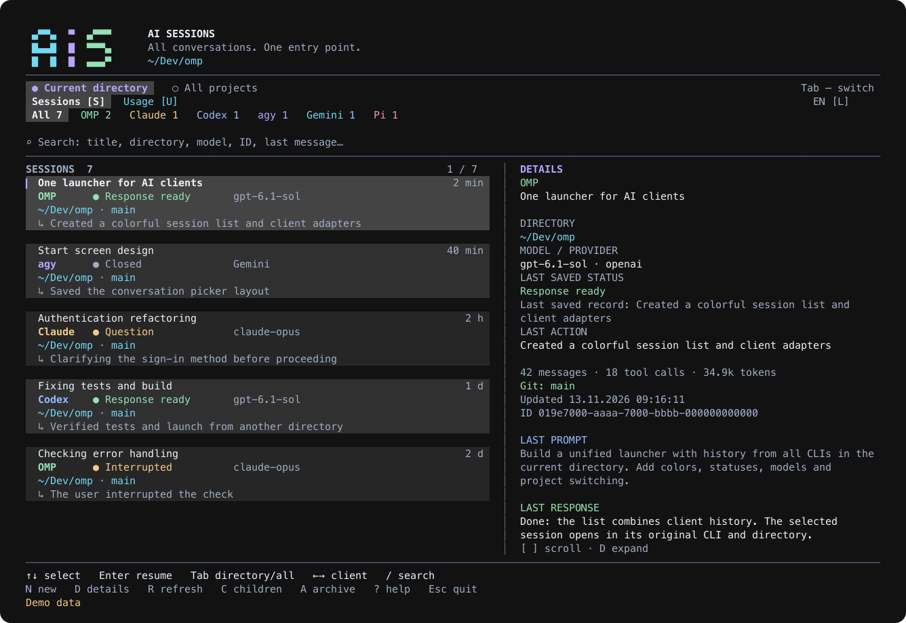

# ais · AI Sessions — десктопное приложение

[English](README.md) · Русский

Нативное GPU-приложение для работы с AI-CLI (**Claude Code, Codex, Gemini CLI,
agy, OMP и Pi**) рядом в одном окне, по проектам, со статусами агентов,
лимитами тарифов и возобновлением любой сохранённой беседы в один клик.

Оконный компаньон терминального лаунчера [`ais`](../README.md), читающий те же
локальные истории. Без Electron и аккаунтов — один бинарник ~6 МБ.



## Установка

Требуется Rust (**1.88+** на macOS 11.0+ или Linux; поддержка Linux сейчас
экспериментальная).

```sh
cd ais-shell
./bundle.sh --install        # macOS: собирает dist/ais.app и копирует в /Applications
# или запуск напрямую
cargo run --release -- ~/code/my-project --run claude
```

```
ais-shell [PATH] [--run omp|claude|codex|agy|gemini|pi|shell]
```

Списки бесед и лимиты приходят от Python-индексатора `ais` из родительской
папки (`$AIS_BIN`, затем `PATH`, затем рядом с бинарником). Без `ais` приложение
продолжает работать как многопанельный терминал для AI-CLI.

## Требования

- **macOS:** 11.0+. Векторные иконки интерфейса встроены в приложение; Nerd Font
  (JetBrains Mono, Fira Code или Hack) необязателен и нужен только для
  дополнительных символов в терминале.
- **Linux (экспериментально):** утилиты времени выполнения `zenity` (выбор
  папки), `notify-send` (уведомления) и `xdg-open` (ссылки и папки). Для
  сборки из исходников нужны `libxkbcommon-dev`, заголовки `libwayland-dev` /
  X11, `libgl-dev` и `libgtk-3-dev`.
  > Примечание: на Linux основной модификатор шорткатов — `Ctrl+`, поэтому
  > сочетания вроде `Ctrl+D` и `Ctrl+W` перехватываются приложением, если не
  > переназначить их в Настройках (`Ctrl+,`).

## Возможности

- **Карточки агентов:** живые статусы (`working`, `waiting`, `needs you`,
  `error`, `finished`, `idle`) со значками состояния, а также 5-часовые и
  недельные лимиты. Одиночный клик переходит к запущенному агенту, **двойной
  клик** по неактивной карточке запускает новую сессию, правый клик открывает
  меню.
- **Панель лимитов (⌘U):** кэшированные снимки загружаются автоматически;
  фоновый живой опрос через официальные CLI **отключён по умолчанию** и
  включается в Настройках (`Terminal → Auto-refresh live usage limits`) либо
  кнопкой ↻.
- **Настоящий терминал (`alacritty_terminal`):** kitty-протокол (`⇧↵`/`⌥↵`),
  IME-ввод, OSC 8 ссылки, `⌘`-клик по URL даже в режиме мыши, поиск по истории
  (`⌘F`), подтверждение многострочной вставки без bracketed paste, перетаскивание
  файлов (пути) и папок (пространства).
- **15 тем интерфейса** (каждая в светлом/тёмном/системном варианте с
  проверенным контрастом WCAG) и **8 терминальных палитр**.
- **Переназначаемые шорткаты** с проверкой конфликтов с фиксированной
  навигацией (`⌘1–9`, `⌘⇧1–6`, `⌘⌥↑↓←→`, vim-режим).

## Приватность и устранение неполадок

- Читаются только локальные истории и базы данных CLI без изменений; прямой
  сетевой активности у `ais-shell` нет.
- Доступ к чтению буфера обмена через OSC 52 заблокирован; запись через OSC 52
  отключается в Настройках.
- При запуске из Finder/Dock переменные окружения импортируются из login-шелла
  (`AIS_FORCE_LOGIN_PATH=1` принудительно включает импорт и из терминала).
- Ad-hoc подпись на macOS: при блокировке Gatekeeper выполните
  `xattr -cr /Applications/ais.app` или откройте через правый клик → Открыть.
- Логи и отчёты о падениях пишутся в
  `${XDG_STATE_HOME:-~/.local/state}/ais-shell/ais-shell.log`.

---

*Проект не аффилирован с Anthropic, OpenAI или Google. Лицензия MIT — см. [LICENSE](LICENSE).*
